<div align="center">


# مستشفى المروة

### نظام إدارة مستشفى متكامل ومصمم سير عمل مرئي

**تقديم شركة سوفت استريم — Soft Stream**

[🔗 فتح النسخة التجريبية](https://mohamedashraf2814-cmyk.github.io/Elmarwa/) · [طريقة التشغيل](#-طريقة-التشغيل) · [تنزيل التطبيق](#-تنزيل-التطبيق-pwa) · [الدخول](#-الدخول) · [سيناريو العرض](docs/DEMO-SCRIPT.md)

</div>

---

> **نسخة واجهة أمامية للعرض التقديمي.** كل البيانات وهمية ومولّدة تلقائياً، وتُحفظ في متصفح المستخدم فقط. لا يوجد خادم ولا قاعدة بيانات ولا يتم إرسال أي بيانات لأي جهة.

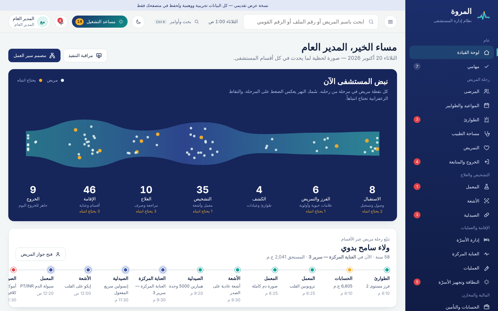

## ما هو هذا المشروع؟

نظام يدير مستشفى المروة **كمستشفى واحد مترابط**، لا كمجموعة شاشات منفصلة. كل مريض له ملف واحد، وكل إجراء ينتقل تلقائياً للقسم التالي:

```
الطوارئ ← الفرز ← طلب تحاليل ← المعمل (+ مهمة سحب للتمريض) ← النتيجة تعود للطبيب
       ← قرار الدخول ← أنسب سرير متاح ← مهام التمريض + احتساب الإقامة
       ← الخروج (الطبيب، الصيدلية، الاستقبال، التمريض، الحسابات) ← ترحيل الفاتورة ومطالبة التأمين
       ← السرير للنظافة ← انتهاء التجهيز ← اقتراح السرير لأول مريض ينتظر
```

**حساب واحد للمدير العام** يدير كل الأقسام بنفسه، ومعه **مساعد تشغيل ذكي** يقرأ حالة المستشفى كلها، ويقترح الخطوة التالية، وينفذها بنقرة.

## ✨ أبرز المميزات

| المجال | ما يقدمه النظام |
|---|---|
| **الترابط بين الأقسام** | الطلب يصل للقسم المختص فوراً، والخدمة تُحسب على فاتورة المريض تلقائياً عند تنفيذها، والنتيجة تعود للطبيب، والخروج يحرر السرير ويرسله للنظافة |
| **جواز المريض** | ملف واحد يوضح: أين المريض الآن، الزيارة المفتوحة، الطلبات المعلقة، النتائج الحرجة، المستحق عليه، الخطوة التالية، ورحلته عبر الأقسام — مع أزرار طلب تحاليل وأشعة ووصفة ودخول وخروج وموعد |
| **مساعد التشغيل** | يكتشف الاختناقات: حالات تنتظر الفرز، نتائج حرجة بلا إقرار، سرير متاح لمريض ينتظر، مرضى جاهزون للخروج، نقص مخزون، نقص تمريض، أجهزة معطلة — وينفذ الحل بنقرة. **لا يقترح تشخيصاً أو علاجاً أبداً** |
| **مصمم سير العمل** | صناديق المهام، معيّنات القرارات، تفرعات متوازية ودمج، مؤقتات، مسارات خطأ وتصعيد، سحب وإفلات، تحقق قبل النشر، إصدارات، استيراد وتصدير، محاكاة، ومراقبة حية لمسار كل مريض |
| **الأقسام (28 شاشة)** | الطوارئ، العيادات والمواعيد، مساحة الطبيب، التمريض، الخروج، المعمل، الأشعة، الصيدلية، الأسرّة، العناية المركزة والحضانات، العمليات، النظافة، الحسابات والتأمين، المخزون، الموارد البشرية والمناوبات، صيانة الأجهزة، السجلات الطبية، الجودة، وغيرها |
| **الأمان** | تحقق ثنائي، فصل المهام مع اعتماد استثنائي موثق للمدير العام، سجل تدقيق ببصمات متسلسلة، إخفاء الرقم القومي |
| **تطبيق قابل للتثبيت** | زر تنزيل في شاشة الدخول، يعمل كتطبيق مستقل على الجوال والكمبيوتر وبدون إنترنت |
| **تجربة الاستخدام** | لوحة أوامر (Ctrl+K) للوصول لأي مريض أو قسم أو إجراء، ووضع المناوبة الليلية، وواجهة عربية متجاوبة مع الجوال |

## 🖼️ لقطات من النظام

| جواز المريض | مساعد التشغيل |
|---|---|
| 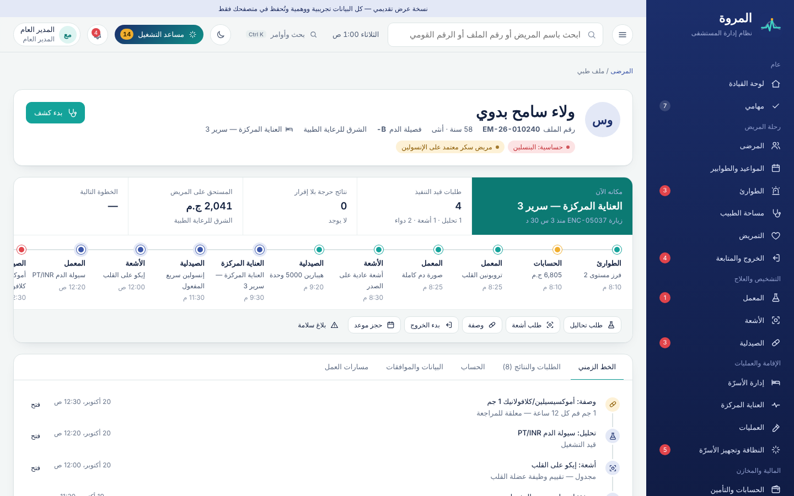 | 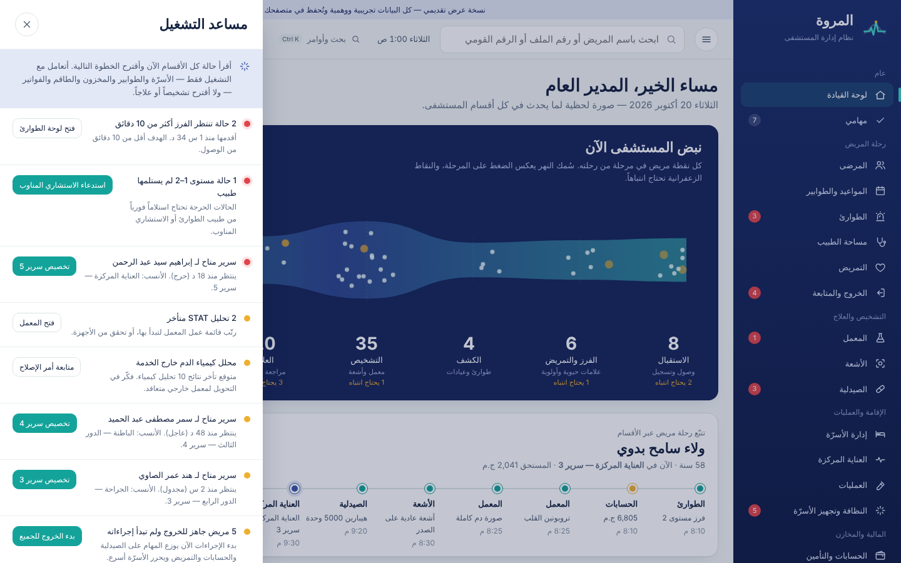 |
| **مصمم سير العمل** | **المحاكاة** |
| 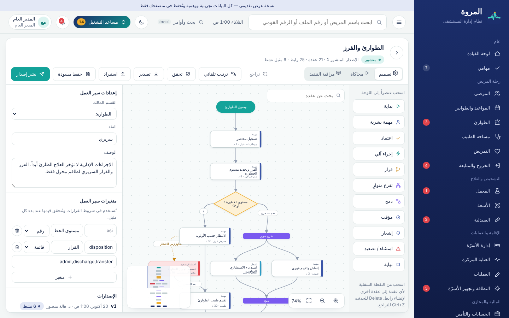 | 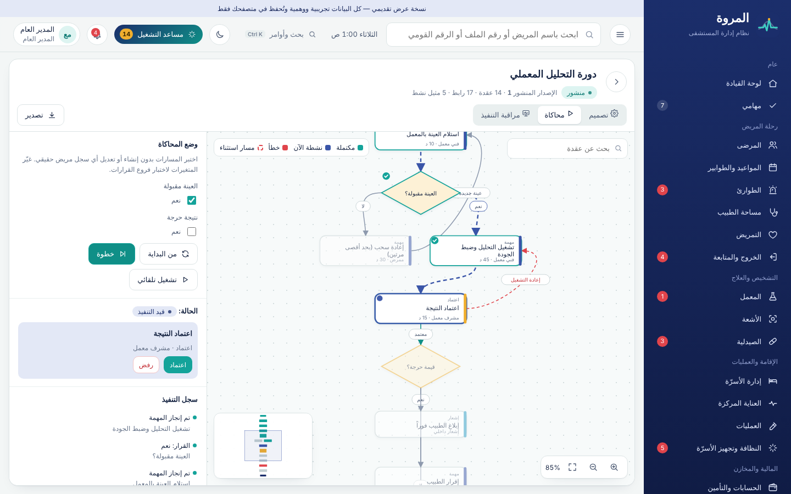 |
| **العناية المركزة** | **الخروج والمتابعة** |
| 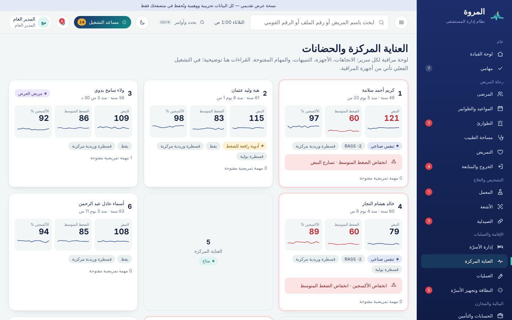 | 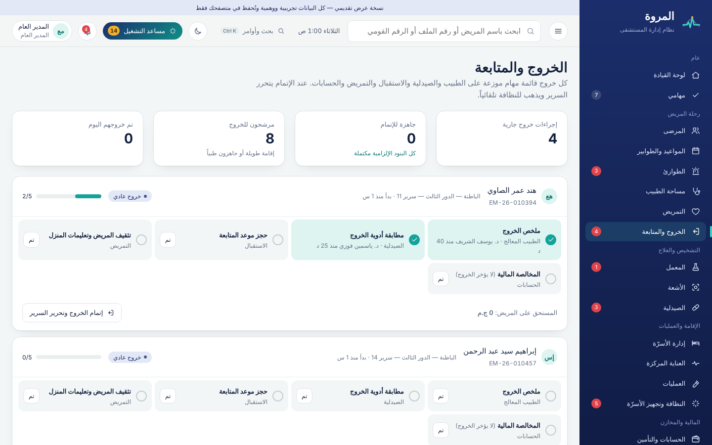 |
| **الأسرّة** | **النظافة وتجهيز الأسرّة** |
| 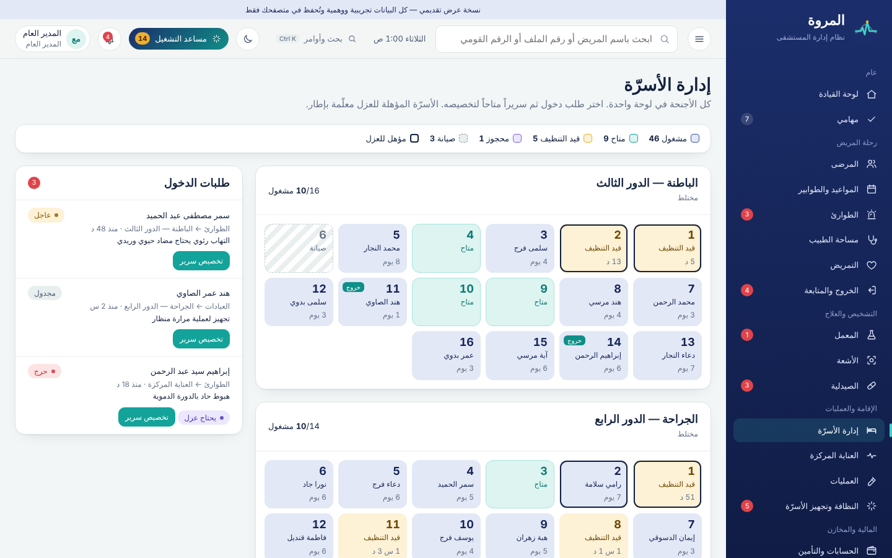 | 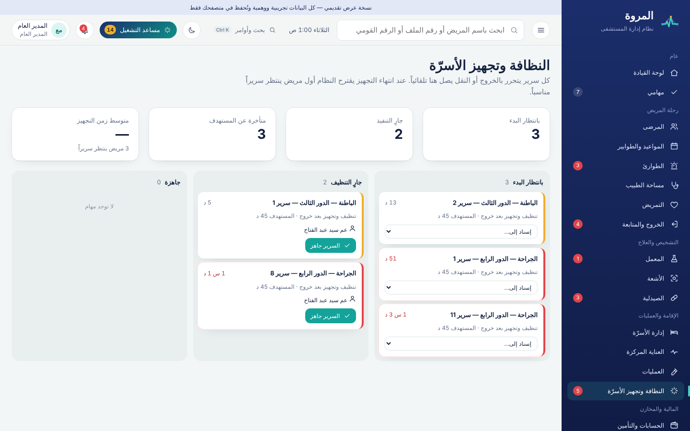 |
| **الطوارئ والفرز** | **المناوبات والطاقم** |
| 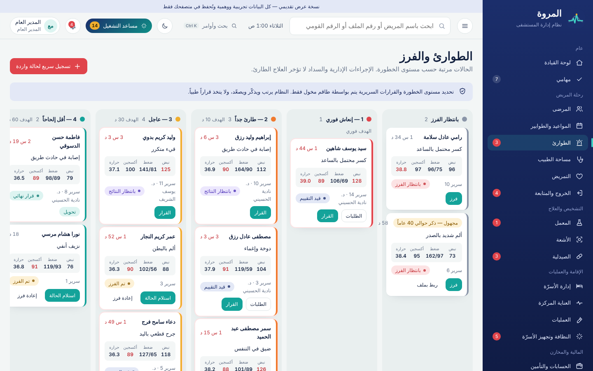 | 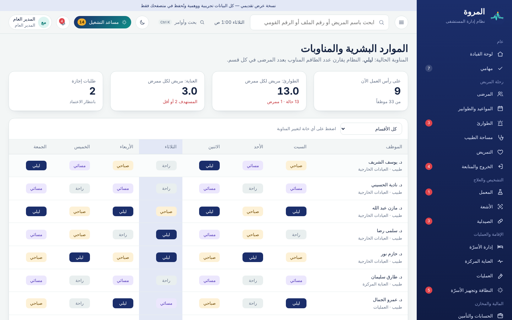 |
| **وضع المناوبة الليلية** | **مراقبة تنفيذ مسار مريض** |
| 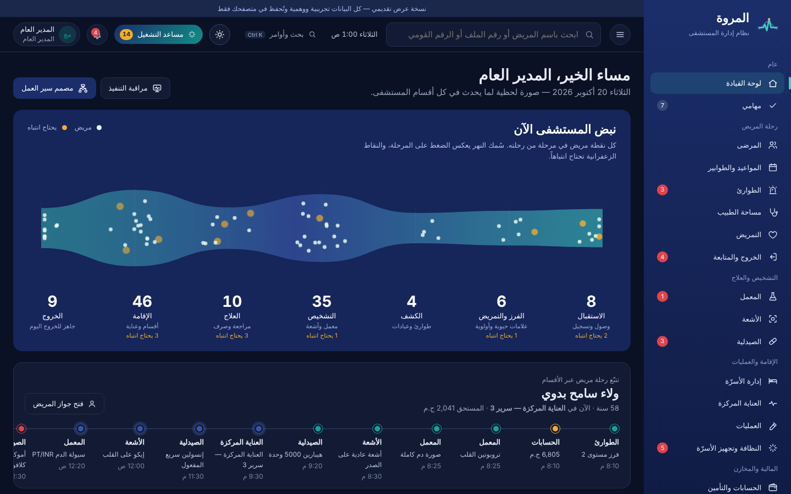 | 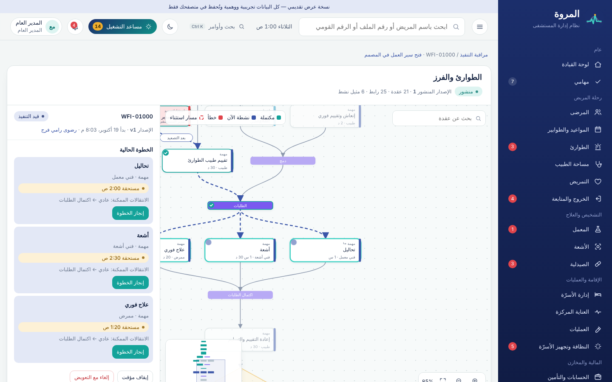 |

## 🚀 طريقة التشغيل

النظام **لا يحتاج أي تثبيت أو بناء** (HTML + CSS + JavaScript فقط، بدون مكتبات خارجية).

### الطريقة الأولى: الرابط المباشر

**https://mohamedashraf2814-cmyk.github.io/Elmarwa/**

> لتفعيل الرابط لأول مرة: من صفحة المستودع **Settings ← Pages ← Source: GitHub Actions**، ثم من تبويب **Actions** أعد تشغيل «نشر على GitHub Pages». بعدها يتحدث الرابط تلقائياً مع كل تعديل.

### الطريقة الثانية: فتح الملف مباشرة

1. حمّل المشروع: زر **Code ← Download ZIP** ثم فك الضغط، أو:
   ```bash
   git clone https://github.com/mohamedashraf2814-cmyk/Elmarwa.git
   ```
2. افتح ملف `index.html` بالضغط المزدوج في Chrome أو Edge أو Firefox.

### الطريقة الثالثة: خادم محلي (مُستحسن للعرض)

```bash
cd Elmarwa
python3 -m http.server 8080     # أو: npx serve .
```

ثم افتح: `http://localhost:8080`

> الخطوط (El Messiri و Readex Pro) تُحمّل من Google Fonts عند توفر الإنترنت، وبدونه يعمل النظام كاملاً بخطوط الجهاز.

**قبل أي عرض جديد:** «عن النظام ← إعادة البيانات التجريبية».

## 📲 تنزيل التطبيق (PWA)

النظام **تطبيق ويب قابل للتثبيت**: زر **«تنزيل تطبيق المروة»** موجود في شاشة الدخول.

- **أندرويد والكمبيوتر (Chrome / Edge):** اضغط الزر فتظهر نافذة التثبيت مباشرة.
- **iPhone و iPad:** يعرض الزر الخطوات: Safari ← زر المشاركة ← «إضافة إلى الشاشة الرئيسية».
- بعد التثبيت يفتح كتطبيق مستقل بأيقونة المروة، **ويعمل بدون إنترنت** بعد أول تشغيل، ويتحدث تلقائياً عند نشر أي تعديل.
- اختصارات من أيقونة التطبيق مباشرة إلى: الطوارئ، إدارة الأسرّة، مصمم سير العمل.

> التثبيت يحتاج فتح النظام من رابط إنترنت (https) مثل رابط GitHub Pages، وليس بفتح ملف `index.html` من الجهاز.
> عند تعديل أي ملف محلياً شغّل `bash scripts/gen-sw.sh` لتحديث قائمة ملفات التطبيق (يتم ذلك تلقائياً عند النشر).

## 🔑 الدخول

| | |
|---|---|
| اسم المستخدم | `admin` |
| كلمة المرور | `elmarwa` |
| رمز التحقق الثنائي | `246810` |

حساب **المدير العام** يرى كل الأقسام ويعمل في كلها. قواعد فصل المهام تبقى مفعلة (مثل: من أدخل النتيجة لا يعتمدها)، ويستطيع المدير العام تجاوزها **باعتماد استثنائي** يُطلب له سبب ويُسجل في التدقيق.

وللتجربة بدور موظف في قسم معين (موظف استقبال، ممرض فرز، طبيب، صيدلي، محاسب…): «تجربة النظام بدور موظف» أسفل شاشة الدخول — 24 دوراً متاحاً، وكل دور يرى ما يخصه فقط.

## 🧑‍⚕️ مريض العرض

مريضة اسمها **ولاء سامح بدوي** تمر رحلتها اليوم بكل الأقسام: وصلت للطوارئ بألم في الصدر ← فرز مستوى 2 ← تحاليل STAT ونتيجة تروبونين حرجة أقرها الاستشاري ← أشعة صدر ← هيبارين من الصيدلية ← العناية المركزة سرير 3 ← طلبات جديدة قيد التنفيذ، بينها وصفة معلقة لأن لديها حساسية من البنسلين. رحلتها ظاهرة في لوحة القيادة، وكل التفاصيل في جواز المريض الخاص بها.

## 🔁 مسارات العمل المضمنة (15 مساراً)

جميعها تجتاز التحقق وتُختبر بالتشغيل حتى النهاية:

| المسار | الفئة | العقد | الروابط | المتغيرات |
|---|---|---|---|---|
| رحلة المريض الكاملة | رحلة المريض | 13 | 16 | نوع الزيارة، يحتاج دخول، يحتاج جراحة |
| تسجيل المريض والتحقق من الهوية | التسجيل | 12 | 15 | ملف موجود، مكرر محتمل، بيانات مكتملة |
| الطوارئ والفرز | سريري | 21 | 25 | مستوى الخطورة، القرار |
| زيارة العيادات الخارجية | سريري | 16 | 19 | مؤمن عليه، توجد طلبات |
| دورة التحليل المعملي | تشخيصي | 14 | 17 | العينة مقبولة، نتيجة حرجة |
| دورة الأشعة | تشخيصي | 10 | 12 | يحتاج فحص سلامة، نتيجة حرجة |
| مراجعة وصرف الدواء | الصيدلية | 11 | 12 | يوجد تنبيه، متوفر بالمخزون |
| الدخول وتخصيص السرير | الإقامة | 14 | 17 | سرير متاح |
| العمليات الجراحية والإفاقة | سريري | 14 | 15 | يحتاج عناية |
| الخروج والمتابعة | الخروج | 14 | 18 | نوع الخروج |
| طلب استرداد مالي | مالي | 8 | 9 | المبلغ |
| مطالبات التأمين | مالي | 11 | 12 | موافقة مسبقة، مقبولة |
| الإبلاغ عن حادث سلامة | الجودة | 8 | 9 | ضرر جسيم |
| التشغيل أثناء تعطل النظام | تشغيلي | 11 | 13 | — |
| الفوترة والتحصيل | مالي | 9 | 10 | مؤمن عليه، تم الدفع |

## 🛡️ قواعد العمل المطبّقة

| القاعدة | أين تراها |
|---|---|
| الطوارئ: لا سداد ولا مستندات قبل العلاج، وتسجيل الحالة المجهولة ثم ربطها بملف لاحقاً | الطوارئ |
| كشف التكرار ومنع الملف المكرر، والبيانات الناقصة تُنشئ ملفاً مؤقتاً ومهمة استكمال | المرضى · السجلات الطبية |
| كل خدمة تُحسب على الفاتورة عند تنفيذها، وتُرحّل الفاتورة وتُرسل مطالبة التأمين عند إغلاق الزيارة | جواز المريض ← الحساب |
| من أدخل نتيجة المعمل لا يعتمدها، والنتيجة الحرجة تنتظر إقرار الطبيب وتُصعّد | المعمل |
| تنبيه الحساسية الدوائية آلي وليس قراراً — التجاوز بتبرير موثق ومراجعة صيدلي | جواز المريض ← وصفة · الصيدلية |
| الصرف يخصم المخزون، ويرسل مهمة الإعطاء للتمريض، والدواء المراقب يحتاج توقيعاً مزدوجاً | الصيدلية |
| مريض العزل لا يُخصص له إلا سرير مؤهل، والتخصيص المتزامن لنفس السرير يُرفض | الأسرّة |
| الخروج لا يتم قبل البنود الإلزامية، والمخالصة المالية لا تؤخره | الخروج |
| العملية لا تنتقل لمرحلتها التالية قبل اكتمال قائمة السلامة | العمليات |
| مقدم طلب الاسترداد أو الشراء لا يعتمده، والدفع بمفتاح عدم تكرار | الحسابات · المخزون |
| تعطل جهاز حرج يُبلغ القسم المتأثر، والمساعد يتوقع تأخر النتائج | صيانة الأجهزة |
| طلب تقرير طبي لطرف ثالث لا يُصرف دون موافقة المريض الموثقة | السجلات الطبية |
| كل محاولة غير مصرح بها أو اعتماد استثنائي يُسجل في التدقيق | التدقيق والأمان |

## 🧱 هيكل المشروع

```
Elmarwa/
├── index.html · manifest.webmanifest · sw.js   (التطبيق القابل للتثبيت)
├── scripts/gen-sw.sh                           يولّد قائمة ملفات العمل بدون إنترنت
├── assets/
│   ├── css/           tokens.css (الهوية + الوضع الليلي) · app.css · views.css · workflow.css
│   └── js/
│       ├── core/
│       │   ├── store.js       الحالة، الجلسة، الصلاحيات، التدقيق
│       │   ├── hospital.js    العقل المركزي: ربط الأقسام والفوترة والأسرّة والخروج
│       │   ├── insights.js    مساعد التشغيل الذكي
│       │   └── ui.js · util.js · icons.js
│       ├── data/              البيانات المرجعية، المولّدات، الاستثناءات، قوالب سير العمل
│       ├── workflow/          engine.js (محرك التنفيذ) · designer.js (المصمم المرئي)
│       ├── views/             شاشة لكل قسم
│       └── app.js             الموجّه، الشريط العلوي، لوحة الأوامر
├── docs/                      ARCHITECTURE · SCENARIOS · DEMO-SCRIPT · screenshots
└── .github/workflows/pages.yml
```

## 🎨 الهوية البصرية

مستوحاة من **خزف القيشاني المصري**: لازوردي `#1B2E6B` للهيكل، فيروزي `#14A39A` للإجراءات والحالة السليمة، حجر بارد `#F3F6F6` للخلفية، زعفراني `#F0AE2E` للتنبيه، وأحمر `#E0444B` للحالات الحرجة. الخطوط: **El Messiri** للعناوين و**Readex Pro** للنصوص. ووضع **المناوبة الليلية** بألوان هادئة لا تُجهد العين في الأقسام المظلمة.

## ⚠️ حدود نسخة العرض

- البيانات **وهمية بالكامل** ولا تمثل أشخاصاً حقيقيين، وقراءات أجهزة المراقبة توضيحية.
- الصلاحيات مطبقة في الواجهة للعرض؛ في الإنتاج تُفرض على الخادم.
- تنبيهات الأدوية أمثلة وليست قاعدة بيانات دوائية معتمدة.
- لا يوجد ادعاء بأي اعتماد أو امتثال تنظيمي. متطلبات القانون المصري للسجلات الطبية وحماية البيانات والأمن السيبراني تحتاج مراجعة قانونية محلية قبل التشغيل الفعلي.

## 🗺️ المرحلة التالية

Laravel + PostgreSQL للخادم مع نقل `engine.js` و`hospital.js` إلى خدمات PHP، وRedis للطوابير والمؤقتات، وVue 3 + TypeScript وVue Flow للواجهة بنفس التصميم، ثم التكامل مع أجهزة المعمل وPACS وشركات التأمين. التفاصيل في [docs/ARCHITECTURE.md](docs/ARCHITECTURE.md).

---

<div align="center">

**مستشفى المروة** · تطوير وتقديم **سوفت استريم — Soft Stream** · 2026

جميع الحقوق محفوظة لشركة سوفت استريم.

</div>
