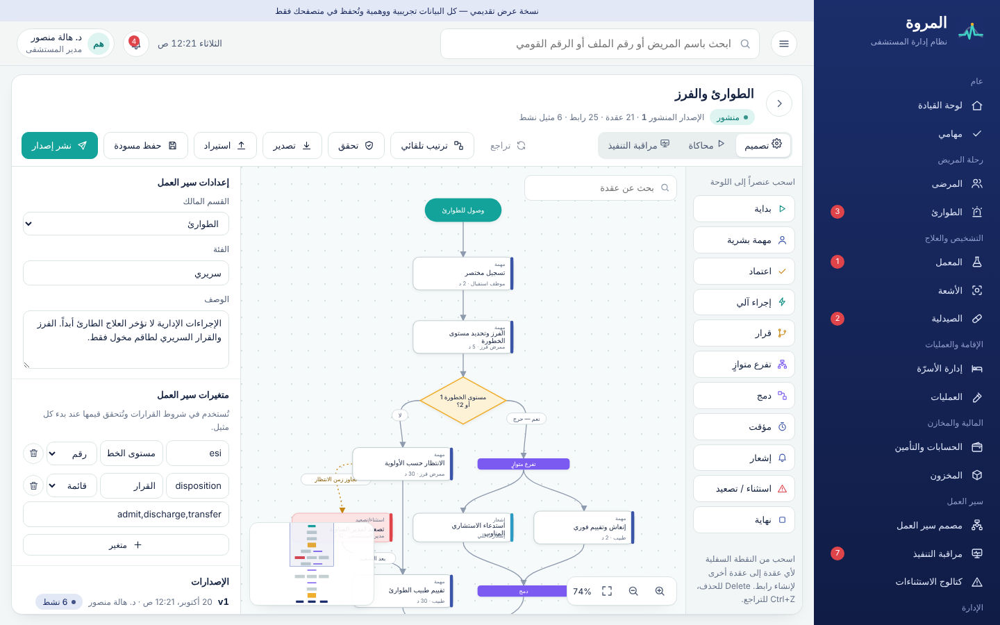
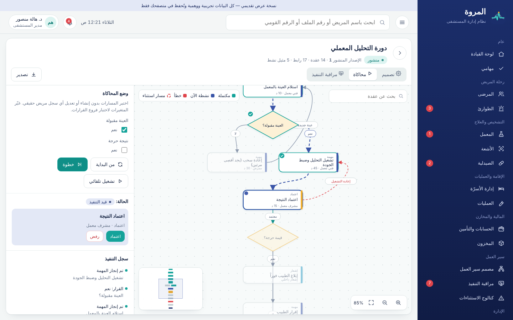
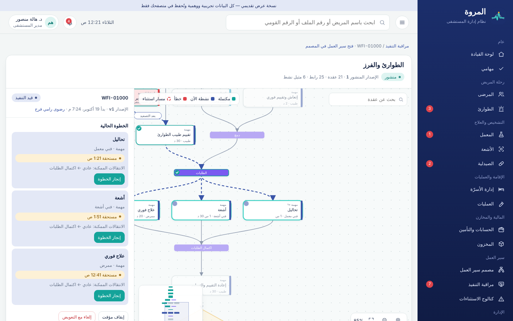
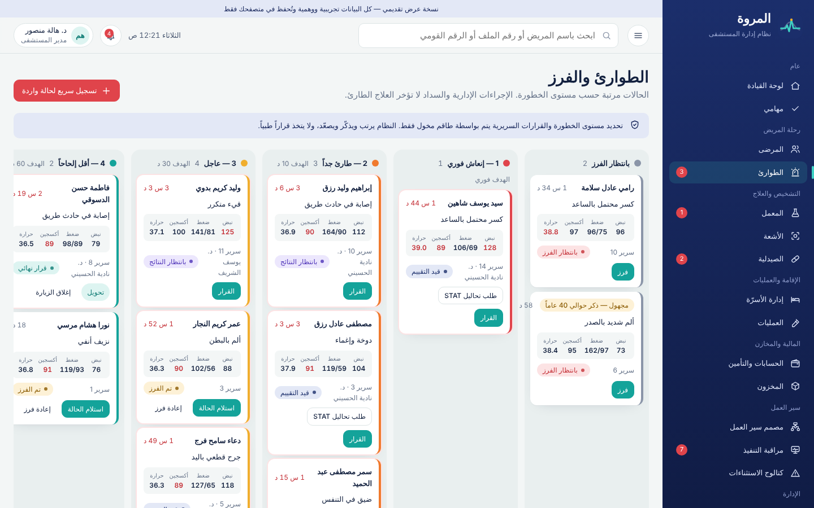
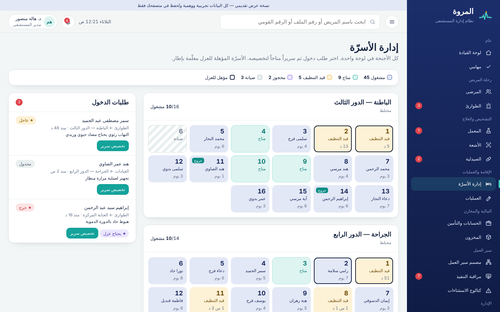
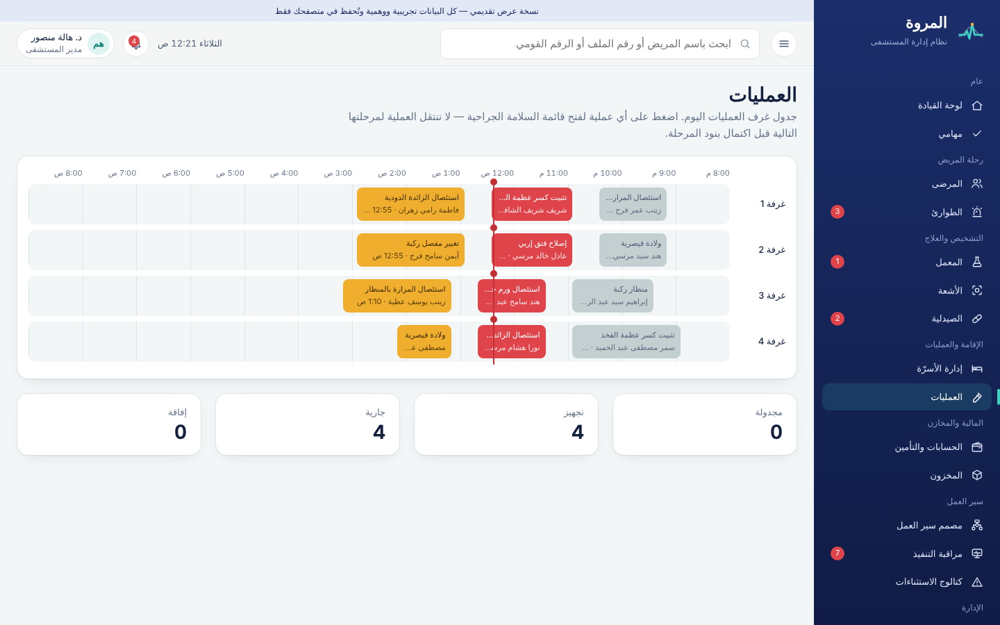
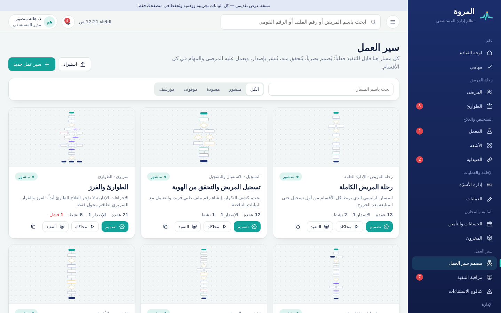
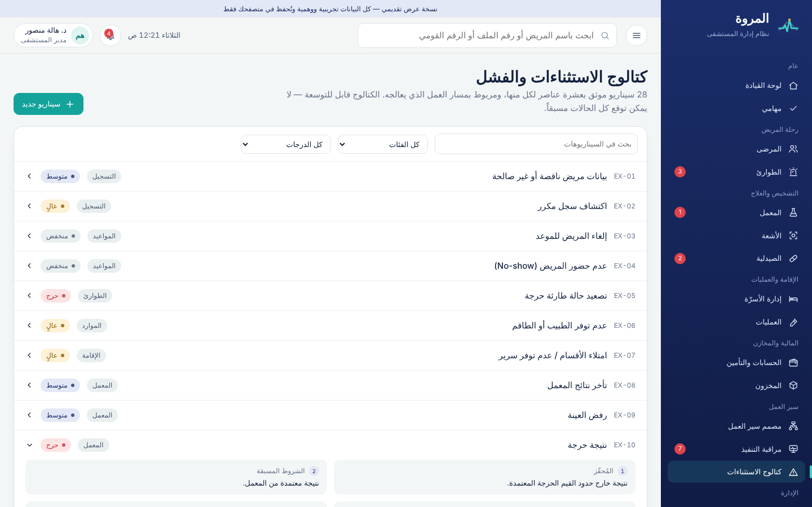

<div align="center">


# مستشفى المروة

### نظام إدارة المستشفى ومصمم سير العمل المرئي

**تقديم شركة سوفت استريم — Soft Stream**

[🔗 فتح النسخة التجريبية](https://mohamedashraf2814-cmyk.github.io/elmarwa/) · [طريقة التشغيل](#-طريقة-التشغيل) · [حسابات العرض](#-حسابات-العرض) · [سيناريو العرض التقديمي](docs/DEMO-SCRIPT.md)

</div>

---

> **نسخة واجهة أمامية للعرض التقديمي.** كل البيانات وهمية ومولّدة تلقائياً، وتُحفظ في متصفح المستخدم فقط. لا يوجد خادم ولا قاعدة بيانات ولا يتم إرسال أي بيانات لأي جهة.


## ما هو هذا المشروع؟

نظام متكامل لإدارة مستشفى المروة، لا يعمل كمجموعة شاشات منفصلة، بل كمستشفى واحد مترابط: **ملف واحد لكل مريض، ومسار عمل واضح لكل خطوة** — من باب الطوارئ حتى المتابعة بعد الخروج.

قلب النظام هو **مصمم سير العمل المرئي** في `/admin/workflows`: كل إجراء في المستشفى (فرز الطوارئ، دورة التحليل، صرف الدواء، الدخول، الخروج، الاسترداد المالي…) مرسوم كصناديق وقرارات وأسهم، **وقابل للتنفيذ فعلياً** — ليس رسماً توضيحياً.

## ✨ أبرز المميزات

| المجال | ما يقدمه النظام |
|---|---|
| **مصمم سير العمل** | عقد مستطيلة للمهام، معيّنات للقرارات، أسهم بعناوين (نعم/لا/معتمد/مرفوض/عاجل)، تفرعات متوازية ودمج، مؤقتات، مسارات خطأ وتصعيد، سحب وإفلات، تكبير وتحريك وخريطة مصغرة وبحث، تراجع (Ctrl+Z)، ترتيب تلقائي |
| **التحقق قبل النشر** | يكتشف العقد غير المتصلة، المسارات التي لا تصل لنهاية، القرارات بدون فرع افتراضي، الاعتمادات الناقصة، الأدوار غير الموجودة، الإجراءات غير المصرح بها، والحلقات بدون قاعدة خروج |
| **الإصدارات** | مسودة ← نشر إصدار ← إيقاف ← أرشفة. المثيلات الجارية تكمل على إصدارها الأصلي |
| **المحاكاة** | تشغيل أي مسار خطوة بخطوة بمتغيرات مختلفة، وفرض الأخطاء وانتهاء المهلة، دون لمس أي سجل مريض |
| **مراقبة التنفيذ** | عرض حي لمسار كل مريض: الخطوات المكتملة، الحالية، المتأخرة، الانتقالات الممكنة، والإيقاف/الاستئناف/الإلغاء مع التعويض |
| **رحلة المريض** | تسجيل مع كشف التكرار ودمج السجلات، مواعيد وطوابير، طوارئ وفرز بخمسة مستويات، مساحة الطبيب، تمريض وتسليم مناوبة، معمل، أشعة، صيدلية، أسرّة، عمليات، خروج |
| **المالية** | فواتير وتأمين ومطالبات، دفع بمفتاح عدم تكرار، استرداد بقيد عكسي واعتماد مزدوج — لا حذف لقيد مُرحّل |
| **الأمان** | 23 دوراً و39 صلاحية، تحقق ثنائي للأدوار الحساسة، فصل المهام، سجل تدقيق إلحاقي ببصمات متسلسلة، إخفاء الرقم القومي |
| **الاستثناءات** | كتالوج 28 سيناريو فشل واستثناء، كل منها بعشرة عناصر، قابل للإضافة من داخل النظام |

## 🖼️ لقطات من النظام

| مصمم سير العمل | المحاكاة |
|---|---|
|  |  |
| **مراقبة تنفيذ مسار مريض** | **الطوارئ والفرز** |
|  |  |
| **إدارة الأسرّة** | **جدول العمليات** |
|  |  |
| **مكتبة مسارات العمل** | **كتالوج الاستثناءات** |
|  |  |

## 🚀 طريقة التشغيل

النظام **لا يحتاج أي تثبيت أو بناء** (HTML + CSS + JavaScript فقط، بدون مكتبات خارجية).

### الطريقة الأولى: الرابط المباشر

افتح: **https://mohamedashraf2814-cmyk.github.io/elmarwa/**

### الطريقة الثانية: فتح الملف مباشرة

1. حمّل المشروع: زر **Code ← Download ZIP** ثم فك الضغط، أو:
   ```bash
   git clone https://github.com/mohamedashraf2814-cmyk/elmarwa.git
   ```
2. افتح ملف `index.html` بالضغط المزدوج في Chrome أو Edge أو Firefox.

### الطريقة الثالثة: خادم محلي (مُستحسن للعرض)

```bash
cd elmarwa

# باستخدام Python (موجود على أغلب الأجهزة)
python3 -m http.server 8080

# أو باستخدام Node.js
npx serve .
```

ثم افتح المتصفح على: `http://localhost:8080`

> **ملاحظة:** الخطوط (El Messiri و Readex Pro) تُحمّل من Google Fonts عند توفر الإنترنت، وبدونه يعمل النظام كاملاً بخطوط الجهاز.

### إعادة البيانات للحالة الأصلية

قبل أي عرض تقديمي جديد: **عن النظام ← إعادة البيانات التجريبية**. أو امسح بيانات الموقع من إعدادات المتصفح.

## 👥 حسابات العرض

اختر أي مستخدم من شاشة الدخول. يمكن تبديل المستخدم في أي وقت من الزر أعلى يسار الصفحة لترى كيف تتغير القوائم والصلاحيات والمهام.

| الدور | المستخدم | يرى ويفعل | تحقق ثنائي |
|---|---|---|---|
| **مدير المستشفى** (الأنسب للعرض) | د. هالة منصور | كل اللوحات، تصميم ونشر سير العمل، الاعتمادات الكبيرة، الأدوار | ✅ الرمز `246810` |
| مدير النظام | م. كريم عادل | سير العمل والإعدادات والتدقيق فقط — **بلا وصول لملفات المرضى** | ✅ الرمز `246810` |
| موظف استقبال | منى سعيد | التسجيل، المواعيد، الطوابير | — |
| ممرض فرز | أحمد فتحي | الطوارئ والفرز | — |
| طبيب | د. يوسف الشريف | مساحة الطبيب، الطلبات، الوصفات | — |
| ممرض | سارة إبراهيم | المهام التمريضية، العلامات الحيوية، التسليم | — |
| مشرف معمل | د. ريهام عبد العزيز | قائمة عمل المعمل واعتماد النتائج | — |
| صيدلي | د. ياسمين فوزي | مراجعة وصرف الوصفات | — |
| محاسب | أ. حسام زكي | الفواتير، المدفوعات، الاسترداد | — |

وكل الأدوار الـ 23 متاحة من «كل الأدوار» أسفل شاشة الدخول.

## 🔁 مسارات العمل المضمنة (15 مساراً)

جميعها تجتاز التحقق وتُختبر بالتشغيل حتى النهاية:

| المسار | الفئة | العقد | الروابط | المتغيرات | الحالة |
|---|---|---|---|---|---|
| رحلة المريض الكاملة | رحلة المريض | 13 | 16 | نوع الزيارة، يحتاج دخول، يحتاج جراحة | سليم ✓ |
| تسجيل المريض والتحقق من الهوية | التسجيل | 12 | 15 | ملف موجود، مكرر محتمل، بيانات مكتملة | سليم ✓ |
| الطوارئ والفرز | سريري | 21 | 25 | مستوى الخطورة (1–5)، القرار | سليم ✓ |
| زيارة العيادات الخارجية | سريري | 16 | 19 | مؤمن عليه، توجد طلبات | سليم ✓ |
| دورة التحليل المعملي | تشخيصي | 14 | 17 | العينة مقبولة، نتيجة حرجة | سليم ✓ |
| دورة الأشعة | تشخيصي | 10 | 12 | يحتاج فحص سلامة، نتيجة حرجة | سليم ✓ |
| مراجعة وصرف الدواء | الصيدلية | 11 | 12 | يوجد تنبيه، متوفر بالمخزون | سليم ✓ |
| الدخول وتخصيص السرير | الإقامة | 14 | 17 | سرير متاح | سليم ✓ |
| العمليات الجراحية والإفاقة | سريري | 14 | 15 | يحتاج عناية | سليم ✓ |
| الخروج والمتابعة | الخروج | 14 | 18 | نوع الخروج | سليم ✓ |
| طلب استرداد مالي | مالي | 8 | 9 | المبلغ | سليم ✓ |
| مطالبات التأمين | مالي | 11 | 12 | موافقة مسبقة، مقبولة | سليم ✓ |
| الإبلاغ عن حادث سلامة | الجودة | 8 | 9 | ضرر جسيم | سليم ✓ |
| التشغيل أثناء تعطل النظام والاستعادة | تشغيلي | 11 | 13 | — | سليم ✓ |
| الفوترة والتحصيل | مالي | 9 | 10 | مؤمن عليه، تم الدفع | سليم ✓ |

## 🛡️ قواعد العمل المطبّقة

| القاعدة | أين تراها |
|---|---|
| الطوارئ: لا سداد ولا مستندات قبل العلاج الطارئ — تسجيل مختصر وحالة «مجهول» | الطوارئ ← تسجيل سريع |
| كشف التكرار بالرقم القومي أو الاسم وتاريخ الميلاد، ومنع إنشاء ملف مكرر | المرضى ← تسجيل مريض |
| البيانات الناقصة تُنشئ ملفاً مؤقتاً ومهمة استكمال بدل الرفض | المرضى ← تسجيل بدون رقم قومي |
| من أدخل نتيجة المعمل لا يعتمدها، والنتيجة الحرجة تنتظر إقرار الطبيب | المعمل |
| مقدم طلب الاسترداد لا يعتمده، والمبالغ فوق 5,000 ج.م تحتاج اعتماداً ثانياً | الحسابات ← الاسترداد |
| الدفع بمفتاح عدم تكرار يمنع الخصم المزدوج | الحسابات ← فتح فاتورة |
| تنبيه الحساسية الدوائية آلي وليس قراراً — التجاوز بتبرير موثق ومراجعة صيدلي | مساحة الطبيب / الصيدلية |
| الدواء المراقب يحتاج توقيعاً مزدوجاً | الصيدلية ← صرف دواء مراقب |
| مريض العزل لا يُخصص له إلا سرير مؤهل للعزل، والتخصيص المتزامن يُرفض | الأسرّة |
| العملية لا تنتقل لمرحلتها التالية قبل اكتمال بنود قائمة السلامة | العمليات |
| كل محاولة غير مصرح بها تُرفض وتُسجل في التدقيق | التدقيق والأمان |
| النظام لا يقترح تشخيصاً ولا يصف علاجاً | مساحة الطبيب |

## 🧱 هيكل المشروع

```
elmarwa/
├── index.html                    # نقطة الدخول الوحيدة
├── assets/
│   ├── css/
│   │   ├── tokens.css            # الألوان والخطوط والمسافات (هوية المروة)
│   │   ├── app.css               # الهيكل والمكونات المشتركة
│   │   ├── views.css             # تنسيقات الشاشات
│   │   └── workflow.css          # مصمم سير العمل
│   ├── img/logo.svg
│   └── js/
│       ├── core/                 # الأدوات، الأيقونات، المخزن والصلاحيات، مكونات الواجهة
│       ├── data/                 # البيانات المرجعية، مولّد البيانات، الاستثناءات، قوالب سير العمل
│       ├── workflow/
│       │   ├── engine.js         # محرك التنفيذ والتحقق (منطق خالص قابل للنقل للخادم)
│       │   └── designer.js       # المصمم المرئي (SVG تفاعلي)
│       ├── views/                # شاشة لكل قسم
│       └── app.js                # الموجّه وهيكل التطبيق
├── docs/
│   ├── ARCHITECTURE.md           # البنية ونموذج البيانات وخطة الانتقال لـ Laravel
│   ├── SCENARIOS.md              # كتالوج الاستثناءات الكامل (28 سيناريو × 10 عناصر)
│   ├── DEMO-SCRIPT.md            # سيناريو عرض تقديمي خطوة بخطوة
│   └── screenshots/
└── .github/workflows/pages.yml   # النشر التلقائي على GitHub Pages
```

## 🎨 الهوية البصرية

مستوحاة من **خزف القيشاني المصري**:

| اللون | القيمة | الاستخدام |
|---|---|---|
| لازوردي | `#1B2E6B` | هيكل التطبيق والعناوين |
| فيروزي | `#14A39A` | الإجراءات الأساسية والحالة السليمة |
| حجر بارد | `#F3F6F6` | الخلفية |
| زعفراني | `#F0AE2E` | التنبيه والانتظار والقرارات |
| أحمر | `#E0444B` | الحالات الحرجة والأخطاء |

الخطوط: **El Messiri** للعناوين و **Readex Pro** للنصوص. الواجهة عربية بالكامل من اليمين لليسار، ومتجاوبة مع الجوال.

## 🧭 لماذا JavaScript أصلي في هذه المرحلة؟

المطلوب في هذه المرحلة **واجهة أمامية للتقديم**. لذلك اخترنا ملفات ثابتة بدون أي أداة بناء:

- تعمل بالضغط المزدوج على `index.html`، أو من أي استضافة ثابتة.
- لا تعتمد على أي مكتبة خارجية قد تتعطل أثناء العرض.
- **محرك سير العمل منفصل عن الواجهة** (`engine.js` منطق خالص)، ليُنقل كما هو إلى خدمات PHP في Laravel، وتُرحّل الشاشات إلى Vue 3 + TypeScript و Vue Flow في المرحلة التالية.

التفاصيل في [docs/ARCHITECTURE.md](docs/ARCHITECTURE.md).

## ⚠️ حدود نسخة العرض

- البيانات **وهمية بالكامل** ولا تمثل أشخاصاً حقيقيين.
- الصلاحيات مطبقة في الواجهة للعرض فقط؛ في الإنتاج تُفرض على الخادم.
- تنبيهات الأدوية أمثلة توضيحية وليست قاعدة بيانات دوائية معتمدة.
- لا يوجد ادعاء بأي اعتماد أو امتثال تنظيمي. متطلبات القانون المصري للسجلات الطبية وحماية البيانات الشخصية والأمن السيبراني تحتاج مراجعة قانونية محلية مختصة قبل التشغيل الفعلي.

## 🗺️ المرحلة التالية

1. **الخادم:** Laravel + PostgreSQL، ونقل محرك سير العمل إلى خدمات مع جداول التعريفات والإصدارات والمثيلات والمهام.
2. **الطوابير والمؤقتات:** Redis + Laravel Queues للإجراءات الآلية وتصعيد SLA وإعادة المحاولة.
3. **الواجهة:** Vue 3 + TypeScript و Vue Flow مع الحفاظ على نفس التصميم.
4. **الأمان:** مصادقة مع MFA، سياسات صلاحيات على الخادم، تشفير، نسخ احتياطي، اختبار اختراق.
5. **التكاملات:** أجهزة المعمل، PACS/RIS، شركات التأمين، الرسائل النصية (HL7/FHIR عند الحاجة).

---

<div align="center">

**مستشفى المروة** · تطوير وتقديم **سوفت استريم — Soft Stream** · 2026

جميع الحقوق محفوظة لشركة سوفت استريم.

</div>
